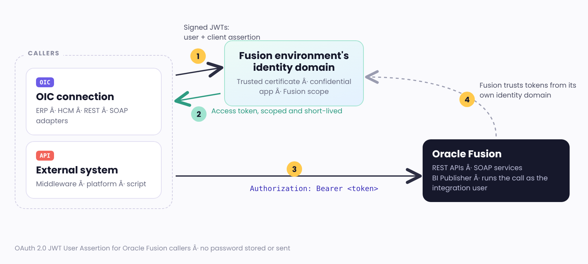
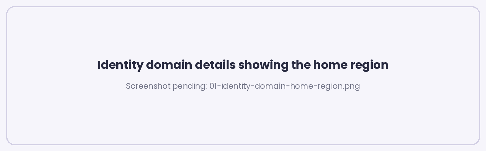

# Oracle Fusion OAuth Setup Guide: Moving Off Basic Authentication

**Oracle Integration 3 · Oracle Fusion Cloud Applications · REST · SOAP · BI Publisher**

Oracle is retiring password-based authentication for Oracle Fusion Cloud Applications REST and SOAP services. Every integration, script, scheduled job and third-party tool that signs in to Fusion with a username and password has to move to a token-based method **before March 31, 2027**.

This guide is the step-by-step companion to my Real-World Oracle Integration newsletter, Edition #4. It is written from setting this up end to end on Oracle Integration 3 and Oracle Fusion in October 2026, and checked against Oracle's documentation as of November 2026.

## Which guide do I need?

| If the caller is… | Use |
|---|---|
| **An Oracle Integration (OIC) connection** calling Fusion: ERP Cloud adapter, HCM Cloud adapter, REST adapter, SOAP adapter (including BI Publisher) | [Guide 1: OIC connections to Fusion](01-oic-connections-to-fusion.md) |
| **Any other system** calling Fusion REST or SOAP APIs: middleware (MuleSoft, Boomi, Azure, Informatica and others), bank or payroll platforms, custom scripts, scheduled jobs | [Guide 2: External systems to Fusion](02-external-systems-to-fusion.md) |

Both guides use the same method and the same Fusion identity domain setup. Guide 1 adds the OIC-specific steps (signing key upload, connection settings, adapter quirks). Guide 2 adds what a non-OIC system has to build itself (signing the assertions, requesting and caching the token, testing with Postman).

## What Oracle is changing

Oracle's customer notice ("Oracle Fusion Applications - Action Required") covers:

- **REST:** the HTTP Basic Authentication scheme.
- **SOAP:** username-token and other password-based authentication policies.
- **Who is affected:** custom integrations, scripts, scheduled jobs, agents, applications and third-party tools that connect to Fusion with a username and password.
- **What happens if you wait:** after enforcement begins, integrations still using passwords may stop authenticating, and scheduled processing may be interrupted.
- **Deadline:** complete the migration before **March 31, 2027**.

Questions to Oracle go through a service request. The category I've used is Product: Any Fusion Cloud Services, Category: Application Security, Sub-Category: API Token Authentication.

## The method: OAuth 2.0 JWT User Assertion

Use **JWT User Assertion** for every caller and every Fusion API type, BI Publisher included.

- **Fusion needs a user.** Fusion authorizes each REST and SOAP call through the roles and data security of a Fusion user. JWT User Assertion keeps that integration user and replaces its password with a certificate you control.
- **Client Credentials will not work for most Fusion APIs.** Oracle supports Client Credentials only for Spectra services, the platform APIs under `/api/...` (for example `/api/boss/...`). Everything else, including `fscmRestApi`, `hcmRestApi`, `crmRestApi` and the SOAP services, accepts Authorization Code, Authorization Code with PKCE and JWT User Assertion only. If you've configured Client Credentials, received a token and still get rejected by Fusion, this is why.
- **Nothing interactive.** No consent sign-in and no refresh token to expire. The only lifecycle task is renewing the certificate before it expires.
- **Authorization Code** is a supported alternative when a caller can't hold a signing key. Each guide has a short section on it.

| | JWT User Assertion (recommended) | Authorization Code (alternative) |
|---|---|---|
| **Setup** | Key pair, trusted certificate, confidential app | Confidential app with redirect URL, then one consent sign-in as the integration user |
| **Secret to protect** | Private key | Client secret and the stored refresh token |
| **Ongoing work** | Renew the certificate before it expires | Re-consent when the refresh token expires or is revoked |
| **Typical failure** | Certificate expiry if nobody tracks it | Silent failure weeks later when the refresh token lapses |

## Three facts to establish first

Most of the problems I hit came from doing the right step in the wrong place. Establish these before you create anything.

| Fact | Where to check | Why it matters |
|---|---|---|
| **The Fusion environment's identity domain** | OCI Console > Identity & Security > Domains. Check every compartment. The right domain lists **Oracle Applications Cloud (Fusion)** under **Oracle cloud services**. Names usually look like `fa-<pod>-<env>-<suffix>`. | This domain issues the tokens Fusion accepts. The certificate, the confidential application and the scope all live here, whatever domain the caller itself is registered in. |
| **The domain's home region** | Domain > Details > Home region | Create and edit identity objects with the console set to the home region. Changes made while viewing a replica region can lag or fail. |
| **The Fusion scope** | Domain > Oracle cloud services > Oracle Applications Cloud (Fusion) > OAuth configuration | The scope is the primary audience and `urn:opc:resource:consumer::all` joined with **no space**, for example `urn:opc:resource:faaas:fa:<pod>urn:opc:resource:consumer::all` or `urn:opc:resource:fa:instanceid=<id>urn:opc:resource:consumer::all`. Copy it, never type it. |

> **One caller environment, one Fusion environment, one setup.** Treat each pairing (for example OIC DEV calling Fusion DEV1) as its own setup with its own key pair and confidential application. An OIC instance that calls two Fusion environments needs the setup in both Fusion domains.

## BI Publisher: what's changed

Many teams are still reading an older Oracle Support note that says JWT isn't supported for BI web services. Oracle's Analytics Publisher Developer's Guide (October 2026) now states that the BI Publisher SOAP web services in Fusion support OAuth access tokens obtained through the JWT User Assertion grant, sent as `Authorization: Bearer <token>`. In my own testing in October 2026, an OIC SOAP adapter connection to `ExternalReportWSSService` switched to **OAuth using JWT User Assertion** ran `runReport` and returned real report data.

Oracle also documents a BI administrator setting for this: **BI Publisher Administration > Runtime Configuration > Properties > All Outputs > Enable OAuth for SOAP Webservices = True**. Check it before you test BI Publisher. Both guides include it.

## Before you start: checklist

- [ ] Inventory every caller that signs in to Fusion with a password, with an owner and a target cutover date.
- [ ] One dedicated Fusion integration user per caller, never a person's account.
- [ ] Access: identity domain administrator in the Fusion domain; OIC ServiceAdministrator (Guide 1); write access to an approved vault.
- [ ] Fusion domain URL, home region and scope recorded for each pairing.
- [ ] A certificate register with an owner and a 30-day renewal alert.
- [ ] Non-production first. Production finished well before March 31, 2027.

## Files in this folder

| File | Contents |
|---|---|
| [01-oic-connections-to-fusion.md](01-oic-connections-to-fusion.md) | OIC ERP, HCM, REST and SOAP (BI Publisher) connections to Fusion |
| [02-external-systems-to-fusion.md](02-external-systems-to-fusion.md) | Middleware, platforms and scripts calling Fusion |
| [scripts/token_test.py](scripts/token_test.py) | Proves the identity setup and a Fusion GET before you touch a live connection |
| [scripts/sign_assertions.sh](scripts/sign_assertions.sh) | Builds the two signed assertions with Bash and OpenSSL only |
| [SCREENSHOTS.md](SCREENSHOTS.md) | The screenshot list behind each step |

## Oracle sources

- Configure OAuth to Access Oracle Fusion Cloud Applications REST APIs (26D): https://docs.oracle.com/en/cloud/saas/applications-common/26d/farca/configure_oauth.html
- Oracle Analytics Publisher: Authenticating Web Services: https://docs.oracle.com/en/cloud/saas/otbi/otbi-pub-dev/authenticating-web-services.html
- Oracle Analytics Publisher: Enable OAuth for SOAP Web Services: https://docs.oracle.com/en/cloud/saas/otbi/otbi-pub-dev/enable-oauth-soap-webservices.html
- SOAP Adapter: Invoke a Web Service with a JWT Assertion: https://docs.oracle.com/en/cloud/paas/application-integration/soap-adapter/invoke-service-api-jwt-assertion.html
- SOAP Adapter: Create a Connection: https://docs.oracle.com/en/cloud/paas/application-integration/soap-adapter/create-connection.html
- ERP Cloud Adapter: Configure JWT Assertions for Outbound Use: https://docs.oracle.com/en/cloud/paas/application-integration/erp-adapter/jwt-user-assertions.html
- Oracle Integration blog: New Adapters and Connectivity Enhancements in Oracle Integration 26.10: https://blogs.oracle.com/integration/new-adapters-and-connectivity-enhancements-in-oracle-integration-26-10

## Revision history

| Version | Date | Change |
|---|---|---|
| 1.0 | November 2026 | First public version: OIC connections and external systems, BI Publisher OAuth property, screenshots. |

---

*Moon Ray Lo, Oracle ACE Apprentice. The postings on this site are my own and do not represent Huron's positions, strategies or opinions. Oracle features and behavior change between releases: confirm each step against Oracle's current documentation for your version, and test in non-production first.*
