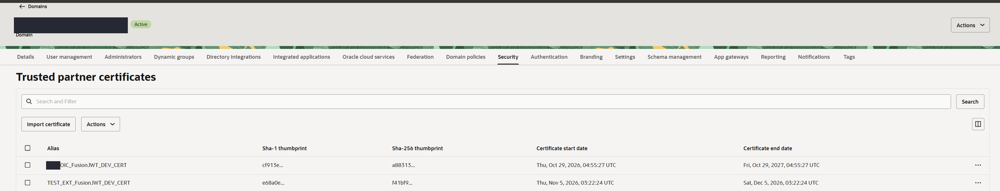
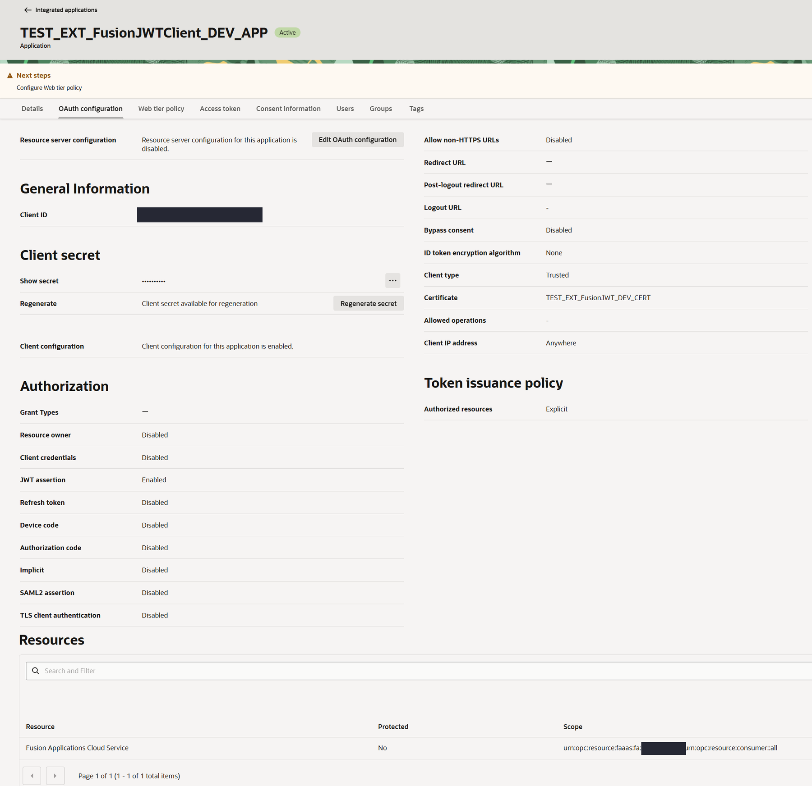
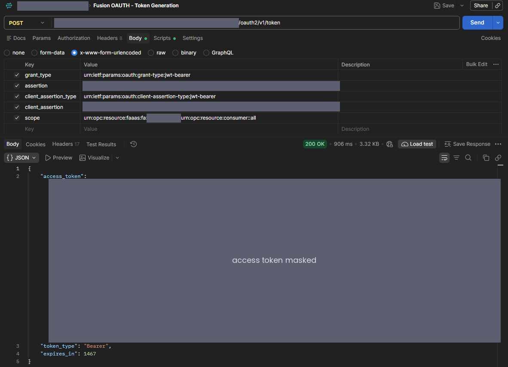
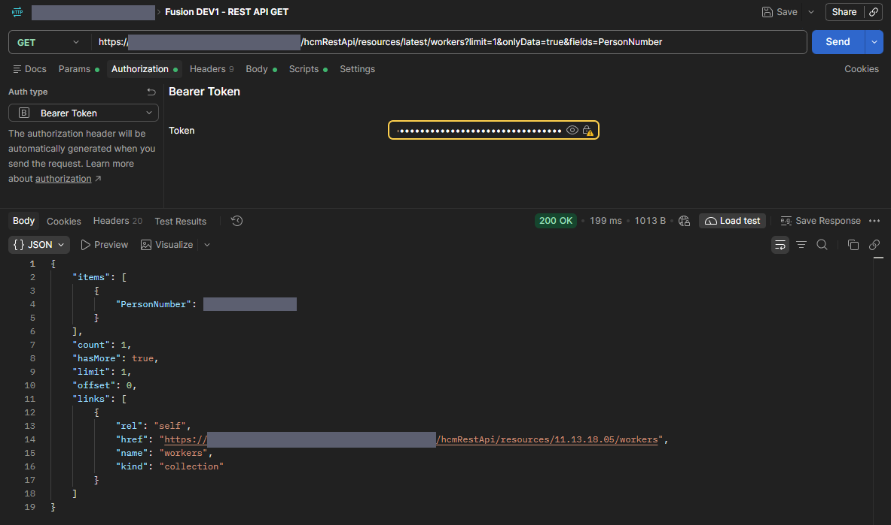
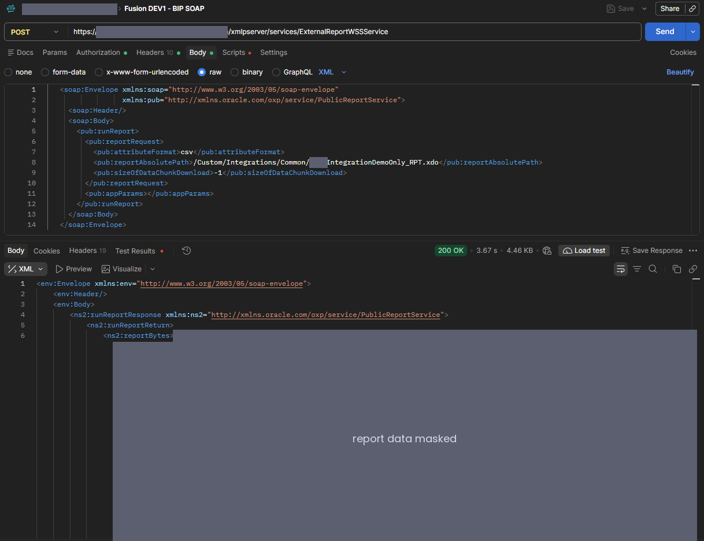
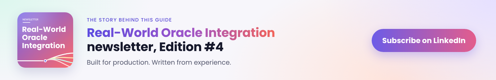

# Guide 2: External Systems to Oracle Fusion with OAuth JWT User Assertion

**Middleware · SaaS platforms · custom scripts · REST · SOAP · BI Publisher · Postman**

[← Back to the overview](README.md)

This guide moves systems other than Oracle Integration that call Oracle Fusion Cloud Applications REST and SOAP APIs from a username and password to **OAuth 2.0 JWT User Assertion**. It's vendor-neutral: any system that can send an HTTPS request and sign a JWT with RS256 can follow it, whether that's MuleSoft, Boomi, Azure Logic Apps, a bank or payroll platform, or a Python script on a scheduler.

It's written for two audiences who need to work together: the Fusion security team, who set up the identity domain side, and the owner and developer of each calling system, who build the token request.

## Contents

- [How it works](#how-it-works)
- [At a glance](#at-a-glance)
- [Step 1: Inventory the callers](#step-1-inventory-the-callers)
- [Step 2: One integration user per system](#step-2-one-integration-user-per-system)
- [Step 3: The system owner creates the key pair](#step-3-the-system-owner-creates-the-key-pair)
- [Step 4: Trust the certificate and create the confidential application](#step-4-trust-the-certificate-and-create-the-confidential-application)
- [Step 5: Build the token request in the system](#step-5-build-the-token-request-in-the-system)
- [Step 6: Test with Postman](#step-6-test-with-postman)
- [Step 7: Cut over and validate](#step-7-cut-over-and-validate)
- [Step 8: Rotate, own and retire](#step-8-rotate-own-and-retire)
- [Alternative: Authorization Code](#alternative-authorization-code)
- [Troubleshooting](#troubleshooting)

## How it works

1. The system signs two short JWTs with its own private key: a **user assertion** naming its Fusion integration user, and a **client assertion** proving it's the registered application.
2. It sends both to the Fusion environment's identity domain and gets back a short-lived access token for the Fusion scope.
3. It calls Fusion REST or SOAP with `Authorization: Bearer <token>`. SOAP requests then need no WS-Security username token.
4. Fusion runs the call as the system's integration user, with that user's roles and data access.

What changes for the system:

- It adds a token request before its Fusion calls, and caches the token. The API calls themselves change only their Authorization header.
- Each system keeps its own integration user, key and application, so one can be revoked without touching the others.
- The system owner looks after two new things: the **private key** and the **certificate's expiry date**.

> **Why not Client Credentials?** Oracle supports the Client Credentials grant only for Spectra services (`/api/...`). Fusion Applications APIs such as `fscmRestApi`, `hcmRestApi`, `crmRestApi` and the SOAP services need a user context, so they accept Authorization Code, Authorization Code with PKCE and JWT User Assertion only. Many middleware teams start with Client Credentials because it looks simplest, get a token, and then see Fusion reject the call.

## At a glance

| # | Step | Who | Result |
|---|---|---|---|
| 1 | Inventory every system calling Fusion with a password | Fusion security, system owners | Caller register with owner and cutover date |
| 2 | Create a dedicated integration user per system | Fusion security | Active user, least-privilege roles |
| 3 | Create the key pair | System owner | Public certificate shared; private key never leaves the system |
| 4 | Trust the certificate, create the confidential app | Identity domain administrator | Client ID and scope sent to the system owner |
| 5 | Build the token request | System developer | Assertions signed, token cached, Bearer calls |
| 6 | Test with Postman | System developer | Token 200, REST and SOAP calls 200 |
| 7 | Cut over and validate | Integration lead, system owner | Password no longer used |
| 8 | Rotate, own and retire | System owner | Renewal date and owner recorded |

> **Rules that matter**
>
> - One key, one confidential application and one integration user **per system**.
> - The **private key stays with the system owner**. Only the public certificate is exchanged.
> - **Non-production first**, with a separate test certificate. Testers never handle production keys.
> - Work in the **Fusion environment's identity domain**, with the console set to its **home region** (see the [overview](README.md#three-facts-to-establish-first)).

## Step 1: Inventory the callers

1. List every Fusion user that a system signs in as with a password. Ask system owners, review service accounts, and check users whose password expiry or sign-in pattern shows automated use.
2. For each one, record the system, its owner, the Fusion environments, the APIs it calls (REST resources, SOAP services, BI Publisher reports), the user, and a target cutover date before March 31, 2027.
3. Flag shared users. If several systems sign in as one Fusion user, give each system its own user during this migration.

| Role | Responsibilities |
|---|---|
| Fusion IT security | Creates integration users and roles; owns the caller register |
| Identity domain administrator | Imports certificates, creates and activates the applications, sets the scope |
| System owner and developer | Creates and protects the key pair, builds the token request, tests, schedules cutover |
| Integration lead | Coordinates testing, cutover and the register; confirms the password is no longer used |

## Step 2: One integration user per system

- Create one Fusion user per system, for example `<ORG>_<SYSTEM>_INTUSER`, with only the roles its APIs need.
- Don't reuse an OIC integration user or a person's account.
- No roles are added for OAuth.
- Keep the password until cutover is proven, then rotate it to an unrecorded value or remove password sign-in according to your security policy.

## Step 3: The system owner creates the key pair

The system owner creates the key pair where the system runs and keeps the private key in the system's own vault or key store. Only the public certificate goes to the Fusion security team.

```bash
openssl req -x509 -newkey rsa:2048 -sha256 -days 365 -nodes \
  -keyout <ALIAS>_private_key.pem -out <ALIAS>.cer -subj "/CN=<ALIAS>"
openssl x509 -in <ALIAS>.cer -noout -subject -enddate -fingerprint -sha256
```

- Alias pattern: `<ORG>_<SYSTEM>_FusionJWT_<ENV>_CERT`. The same value is the identity domain certificate alias and the JWT `kid`.
- Use separate key pairs for non-production and production.
- Record the certificate expiry in the caller register with a renewal alert 30 days before. Validity is your security team's call; I keep it to 12 months.
- Send the `.cer` file and its SHA-256 fingerprint through your normal channel. The fingerprint lets the Fusion team confirm they imported the right certificate.

## Step 4: Trust the certificate and create the confidential application

Work in the Fusion environment's identity domain, with the console region set to its home region.

### 4.1 Import the certificate

**Security > Trusted partner certificates > Import certificate**: upload the system's certificate with the alias from Step 3.



### 4.2 Create the application

1. **Integrated applications > Add application > Confidential Application > Launch workflow**. Name it `<ORG>_<SYSTEM>_FusionJWTClient_<ENV>_APP` and record the system and its owner in the description. **Submit**.
2. **Edit OAuth configuration > Configure this application as a client now.** Under **Authorization**, select **JWT assertion** only.
3. **Client type: Trusted**, with **Import certificate** using the same certificate and alias.
4. **Client IP address**: restrict to the system's egress IP ranges when you know them, otherwise **Anywhere**. The form won't save with neither selected.
5. **Token issuance policy**: **Specific**, **Add resources**, **Add scope**, select the Fusion resource (**Oracle Applications Cloud (Fusion)** or **Fusion Applications Cloud Service**, depending on the domain).
6. **Submit**, then **Actions > Activate**.
7. Send the system owner the **client ID**, the **scope** and the **token URL** (`https://<fusion-domain-host>/oauth2/v1/token`). The generated client secret isn't used.



### 4.3 BI Publisher callers

If the system calls BI Publisher SOAP services (for example `ExternalReportWSSService` `runReport`), check **BI Publisher Administration > Runtime Configuration > Properties > All Outputs**. If **Enable OAuth for SOAP Webservices** is listed, a BI administrator sets it to **True**, as Oracle's Analytics Publisher Developer's Guide documents. If it isn't listed, no change is needed: on a 26C pod the property wasn't there, and a direct `runReport` call with the Bearer token returned report data (Step 6). See [Guide 1, Step 7](01-oic-connections-to-fusion.md#step-7-check-the-bi-publisher-oauth-property).

## Step 5: Build the token request in the system

### 5.1 The two assertions

| Part | User assertion | Client assertion |
|---|---|---|
| Header | `alg` RS256, `typ` JWT, `kid` = certificate alias | Same |
| `iss` | Client ID | Client ID |
| `sub` | The system's Fusion integration user | Client ID |
| `aud` | `https://identity.oraclecloud.com/` (with the trailing slash) | Same |
| `iat`, `exp` | Now, and now + up to 30 minutes | Same |
| `jti` | Unique value per assertion | Unique value per assertion |

### 5.2 Token request

```bash
curl -s -X POST "https://<fusion-domain-host>/oauth2/v1/token" \
  -H "Content-Type: application/x-www-form-urlencoded" \
  --data-urlencode "grant_type=urn:ietf:params:oauth:grant-type:jwt-bearer" \
  --data-urlencode "assertion=$USER_ASSERTION" \
  --data-urlencode "client_assertion_type=urn:ietf:params:oauth:client-assertion-type:jwt-bearer" \
  --data-urlencode "client_assertion=$CLIENT_ASSERTION" \
  --data-urlencode "scope=<Fusion scope>"
```

The response holds `access_token`. Call Fusion with `Authorization: Bearer <access_token>`.

### 5.3 Python

```python
import time, uuid, jwt, requests          # pip install pyjwt cryptography requests
CLIENT_ID, ALIAS, USER = "<client id>", "<alias>", "<integration user>"
TOKEN_URL = "https://<fusion-domain-host>/oauth2/v1/token"
SCOPE = "<Fusion scope>"
key = open("private_key.pem").read()      # load from the system's vault in production

def assertion(sub, lifetime=1800):
    now = int(time.time())
    return jwt.encode({"iss": CLIENT_ID, "sub": sub, "aud": "https://identity.oraclecloud.com/",
                       "iat": now, "exp": now + lifetime, "jti": str(uuid.uuid4())},
                      key, algorithm="RS256", headers={"kid": ALIAS, "typ": "JWT"})

r = requests.post(TOKEN_URL, timeout=30, data={
    "grant_type": "urn:ietf:params:oauth:grant-type:jwt-bearer",
    "assertion": assertion(USER),
    "client_assertion_type": "urn:ietf:params:oauth:client-assertion-type:jwt-bearer",
    "client_assertion": assertion(CLIENT_ID),
    "scope": SCOPE})
r.raise_for_status()
token = r.json()["access_token"]
```

### 5.4 Bash and OpenSSL only

For systems without a JWT library, [`scripts/sign_assertions.sh`](scripts/sign_assertions.sh) builds both assertions with OpenSSL. Java, .NET and PowerShell follow the same pattern with their standard JWT libraries: two RS256 tokens with the claims in 5.1, then the form post in 5.2.

### 5.5 Middleware notes

- **Token policies.** Most middleware has an OAuth token policy or connector that supports a "JWT bearer" grant. Check that it can send both `assertion` and `client_assertion` in the same form post. If it can only send one, build the assertions in a small script or custom policy and pass them in.
- **SOAP calls.** Remove the WS-Security `UsernameToken` from the SOAP header and send the Bearer token as an HTTP header instead.
- **Keys.** Store the private key in the platform's secure property store or vault, not in flow configuration or source control.

### 5.6 Token handling

- The token's lifetime follows the user assertion's `exp`. Reuse the token until about a minute before it expires, then build new assertions. Don't request a token for every call.
- Keep the system clock synchronized. A clock a few minutes off makes the assertions invalid.
- Never log the private key, the assertions or the access token.
- On a 401 from Fusion, request a new token once, then raise an alert.

## Step 6: Test with Postman

Postman acts as the system by sending exactly what the system would send. It can't sign RS256 assertions on its own, so sign them outside Postman (Step 5.3 or 5.4) with the **non-production** key, and paste them into Postman **secret** environment variables.

| Request | Settings |
|---|---|
| 1. Token | `POST <token URL>`; Authorization **No Auth**; Body x-www-form-urlencoded: `grant_type`, `assertion` = `{{user_assertion}}`, `client_assertion_type`, `client_assertion` = `{{client_assertion}}`, `scope`. Post-response script: `pm.environment.set("fusion_token", pm.response.json().access_token)` |
| 2. REST call | `GET` a REST resource the user can read, Authorization **Bearer Token** `{{fusion_token}}`; expect 200 |
| 3. SOAP call | `POST` a SOAP service the user can call, Bearer `{{fusion_token}}`, `Content-Type: text/xml`; expect 200 and a valid response |







> **Keep keys out of Postman.** Don't load a signing library into Postman with a real private key in an environment variable: the key would sit in Postman's sync and run alongside downloaded code.

## Step 7: Cut over and validate

1. Finish Steps 2 to 6 in non-production with the test certificate and application.
2. Repeat Steps 3 and 4 for production with a production key pair and application.
3. In an agreed window, switch the system to OAuth. Run its normal jobs and confirm success in the system and in Fusion.
4. Confirm the password is no longer used (no password sign-ins for the user), then rotate it or remove password sign-in.
5. Update the caller register: method, application, certificate expiry, owner, cutover date.

## Step 8: Rotate, own and retire

- **Renew before expiry.** The system owner creates a new key pair, the new certificate is imported alongside the old one, the system switches, then the old certificate is removed.
- **If a private key is exposed**, remove its certificate from the identity domain straight away and issue a new pair.
- **When a system is retired**, deactivate its application, remove its certificate and deactivate its integration user.
- **Your organization owns the register and every application.** Vendors and partners appear only as implementers.

## Alternative: Authorization Code

Use Authorization Code only when the system can't create or protect a signing key, or its vendor supports only this flow.

1. In the Fusion identity domain (home region), create a confidential application with **Authorization code** and **Refresh token**, the system's **redirect URL** and the Fusion scope. Activate it and send the client ID and secret through a secure channel.
2. The system requests the scope `<Fusion scope> offline_access` so it receives a refresh token.
3. Someone signs in **as the system's integration user** once, in a private browser window, to give consent. The system stores the refresh token in its vault.
4. The system exchanges the refresh token for access tokens and calls Fusion with the Bearer header.
5. Record the consent date and a named owner for re-consent.

## Troubleshooting

| Symptom | Likely cause | Fix |
|---|---|---|
| Token returned, but Fusion rejects every call | Client Credentials grant used against a Fusion Applications API | Switch to JWT User Assertion; Client Credentials works only for `/api/...` Spectra services |
| `invalid_grant` | Assertion expired, clock skew, or wrong `sub`, `kid` or `aud` | Check the clock and claims; `sub` must be an active Fusion user |
| `invalid_client` | Client assertion missing or wrong, or certificate not trusted on the app | Send `client_assertion`; check the app's certificate and alias |
| `invalid_scope` | The two scope parts split by a space, or the wrong pod | Copy the scope from the token issuance policy |
| 401 from Fusion with a valid token | Token expired, or host doesn't match the scope's pod | Request a new token; match host and pod |
| 403 from Fusion | Integration user lacks the role or data access | Grant the minimum role and data security |
| BI Publisher SOAP rejects the Bearer token | Property listed but not set to True, or the user lacks access to the report | Set **Enable OAuth for SOAP Webservices** to True if it is listed (4.3); check the user's access to the report path |
| Authorization Code works for weeks, then 401 | Refresh token expired or revoked | Give consent again as the integration user; confirm `offline_access` in the scope |
| App or certificate change not visible | Made in a replica region | Switch to the home region and retry |

---

Written for the **Real-World Oracle Integration** newsletter on LinkedIn. [Subscribe on LinkedIn](https://www.linkedin.com/newsletters/real-world-oracle-integration-7513260462159888384) for the next edition.

[](https://www.linkedin.com/newsletters/real-world-oracle-integration-7513260462159888384)

---

[← Guide 1: OIC connections to Fusion](01-oic-connections-to-fusion.md) · [Back to the overview](README.md)

*Moon Ray Lo, Oracle ACE Apprentice. The postings on this site are my own and do not represent Huron's positions, strategies or opinions. Confirm each step against Oracle's current documentation for your release.*
