# Oracle Integration CI/CD: Integration-Level Git for OIC 3 Projects

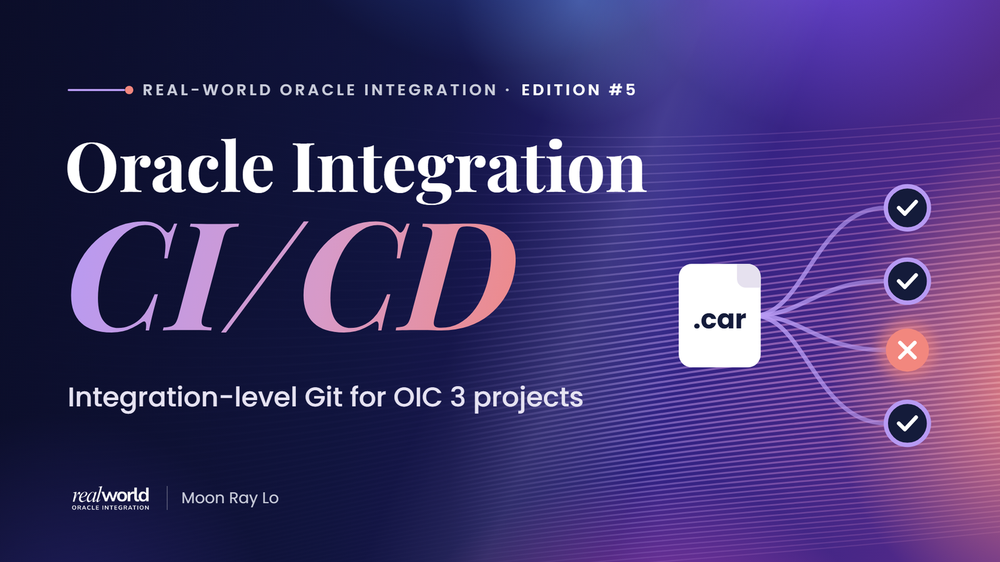

> **Companion to Edition #5 of the [Real-World Oracle Integration](https://www.linkedin.com/newsletters/real-world-oracle-integration-7513260462159888384) newsletter on LinkedIn.** [Read the article](https://www.linkedin.com/pulse/oracle-integration-cicd-integration-level-git-oic-3-lo-psm-ii-4c20e/), [subscribe](https://www.linkedin.com/newsletters/real-world-oracle-integration-7513260462159888384) for the next edition, or [connect with me](https://www.linkedin.com/in/moonraylo).

Oracle Integration 3 can push a project or a project deployment to GitHub in one click, but each lands as a single `.car` archive. Git can tell you the file changed. It can't tell you which integration changed, who changed it, or whether production received exactly that change.

This guide is a **production-ready blueprint** that adds those three things with two small Python scripts and three GitHub Actions workflows, lab-proven on two Oracle Integration 3 instances:

* **Per-integration history.** Every export OIC pushes is unzipped, cleaned of export noise and committed as one folder per integration version.
* **A pre-import guard** on the release pull request, which blocks releases that OIC would reject or silently not apply.
* **A post-import check**, which confirms every released integration version landed in production exactly as released.

Production always receives the untouched `.car` file that OIC exported. Git adds a readable mirror and two checks around the import. Nothing is ever rebuilt from Git.

**Lab-proven on:** Oracle Integration 3 (26.10), two instances and a private GitHub repository, November 2026. Every behavior below has screenshots from the hands-on lab: open the **Screenshots** sections. Instance names, other projects, user names and tokens are masked.

**Requirements:** Python 3 (standard library only), a GitHub repository with Actions enabled.

---

## Contents

* [What's inside a .car](#whats-inside-a-car)
* [Five import behaviors that shape the design](#five-import-behaviors-that-shape-the-design)
* [How the pipeline works](#how-the-pipeline-works)
* [What makes it production-ready](#what-makes-it-production-ready)
* [Try it with the demo exports](#try-it-with-the-demo-exports)
* [Set it up in your repository](#set-it-up-in-your-repository)
* [Release runbook](#release-runbook)
* [Guard and verify findings](#guard-and-verify-findings)
* [Tool reference](#tool-reference)
* [Limitations and things that tripped me up](#limitations-and-things-that-tripped-me-up)
* [Oracle sources](#oracle-sources)

---

## What's inside a .car

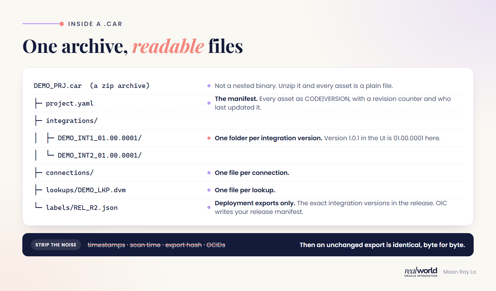

A `.car` is a zip archive of readable files:

| Path | What it holds |
|---|---|
| `project.yaml` | The manifest: every asset as `CODE\|VERSION`, with a revision counter and who last updated it |
| `integrations/<CODE>_<VERSION>/` | One folder per integration version. Version 1.0.1 in the UI is `01.00.0001` here |
| `connections/`, `lookups/*.dvm` | One file per connection and per lookup |
| `labels/<DEPLOYMENT>.json` | Deployment exports only: the exact integration versions in the release |

Exports also carry noise: export timestamps, a best-practice scan time, a hash that changes on every export, and the tenancy and instance OCIDs. With those stripped, two exports with no change in between are identical, byte for byte, and an edit to one integration shows up only in that integration's folder.

## Five import behaviors that shape the design

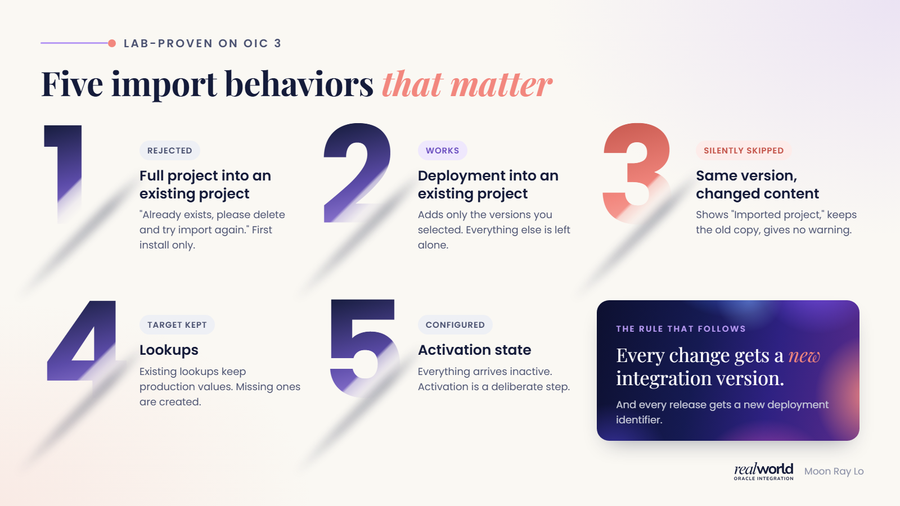

| # | Behavior | Consequence |
|---|---|---|
| 1 | A full project archive is rejected by an instance that already has the project ("already exists, please delete and try import again") | The full project archive is for a first install only |
| 2 | A project deployment imports into an existing project and adds only the versions it holds | Every release is a project deployment |
| 3 | **An integration version that already exists in the target is silently skipped.** OIC shows "Imported project" and keeps the old copy | **Every change bound for production gets a new integration version** |
| 4 | Existing lookups keep their target values; missing lookups are created | Lookup content changes need their own release step |
| 5 | Every imported integration arrives as Configured (inactive) | Activation is always a deliberate step |

Two more details: a deployment identifier can be imported into an instance only once, so every release needs a new identifier; and a deployment carries the lookups its integrations reference. Activating a new minor version deactivates the previous one automatically, which makes rollback a single step: deactivate the new version and reactivate the old one.

I expect connections to behave like lookups (existing connections keep their target configuration), but I didn't test that in the lab.

### Lab evidence

Instance A plays DEV and instance B plays PROD. The test project is `XXMRL_DEMO_OIC_PRJ` with two scheduled integrations (INT1, INT2) and two lookups.

<details>
<summary><b>Behavior 1: a full project archive is rejected where the project exists</b> (5 screenshots)</summary>

<br>

The archive carried deployment `HOTFIX_INT1_101`, which already existed in the target:

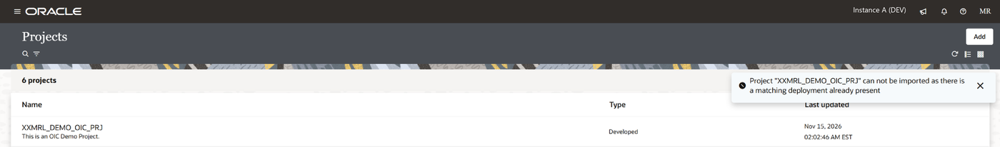

Rejected again with an archive that carried no deployment: the project already exists.


The same archive imports into an instance without the project (the first install), and every integration lands as Configured:

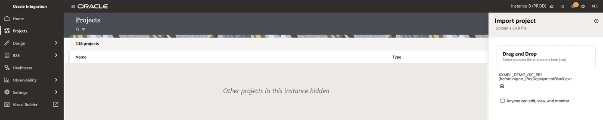
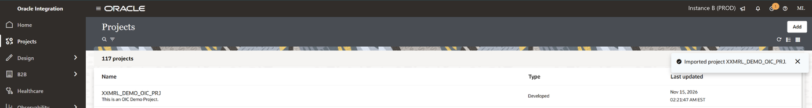
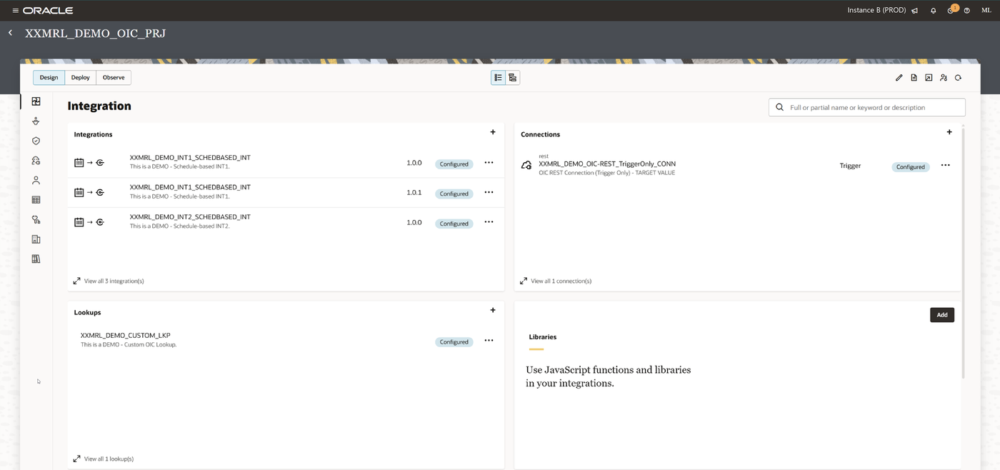

</details>

<details>
<summary><b>Behaviors 2 to 4: release REL_R1 into an existing project</b> (9 screenshots)</summary>

<br>

**Before the release.** Production holds a PROD-only lookup value, `Value1-PROD`:

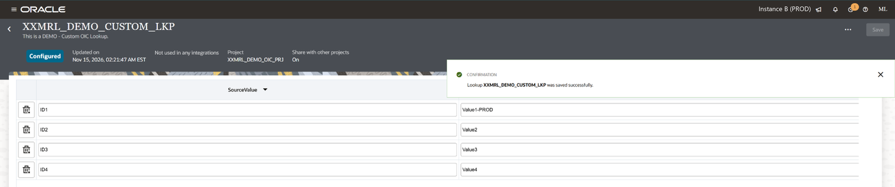

In DEV, INT1 1.0.1 is edited **in place** (the incorrect change) and the existing lookup gets a new row:

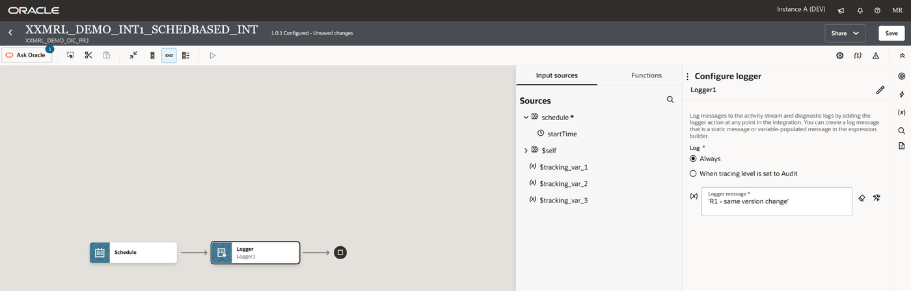
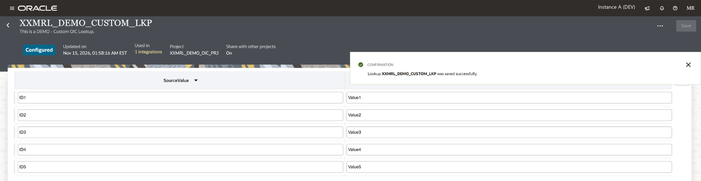

Deployment REL_R1 holds INT1 1.0.1 (same version, changed) and INT2 1.0.1 (new):

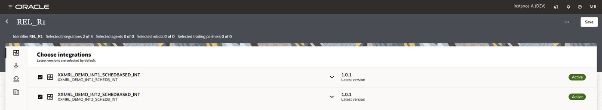

**The import.** OIC reports success:

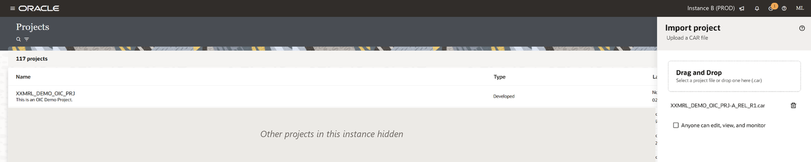
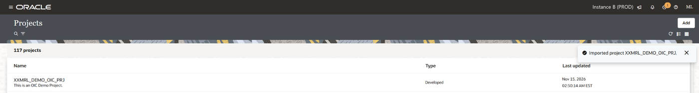

**After the release.** INT2 1.0.1 and the new lookup arrived, Configured. INT1 1.0.1 kept its old content (the post-import check proves it, see the [release guard summary](#how-the-pipeline-works)). The existing lookup kept `Value1-PROD`, and DEV's new row was not added:

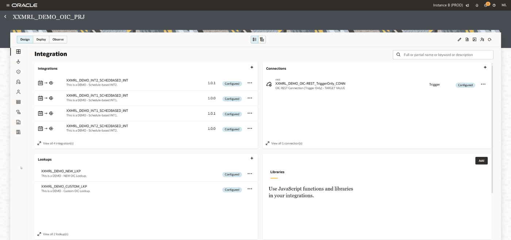
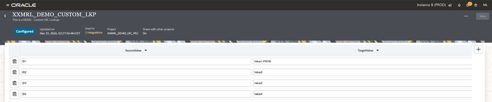

A production run of INT2 1.0.1 logs `Value1-PROD | NewValue1`: the PROD value was kept and the missing lookup was created.

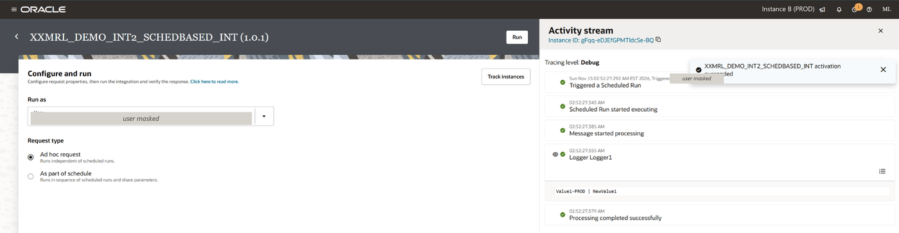

</details>

<details>
<summary><b>Activation: a new minor version deactivates the previous one</b> (1 screenshot)</summary>

<br>

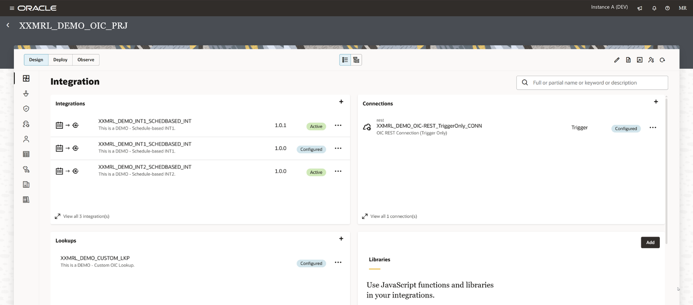

</details>

## How the pipeline works

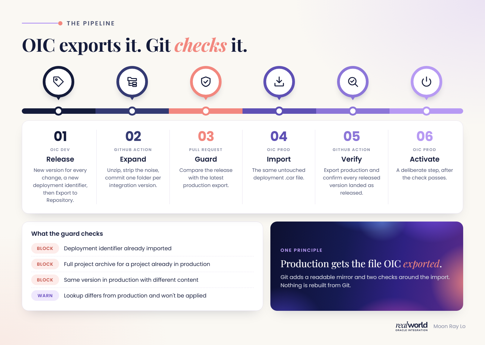

| Branch or folder | Written by | Purpose |
|---|---|---|
| `oic-dev` branch | OIC DEV (Settings > Repository) | Every Export to Repository lands here |
| `projects/*.car` | OIC | Full project exports (Project deployment left blank): DEV history and backup |
| `deployments/*.car` | OIC | Release archives: one project deployment with a new identifier per release |
| `expanded/` | The Expand workflow | Cleaned, one folder per integration version, readable diffs |
| `prod-state/<PROJECT>.car` | You, after each import | The latest production export (Project deployment left blank) |
| `main` branch | Pull requests | Approved releases plus production state |

The three workflows:

| Workflow | Runs on | What it does |
|---|---|---|
| `expand-oic-export.yml` | Push to `oic-dev` that changes a `.car` | Expands each changed archive into `expanded/` and commits it with a message naming each changed integration version and who changed it (OIC's own commits always read "API client checkin" by OIC_Developer) |
| `release-guard.yml` | Pull request into `main` | Runs the tool self-test, then checks each release archive against `prod-state/` on the base branch; fails the pull request on a blocking finding |
| `verify-prod.yml` | Push to `main` that changes `prod-state/`, or manual run | Checks that every release archive on `main` landed in production as released |

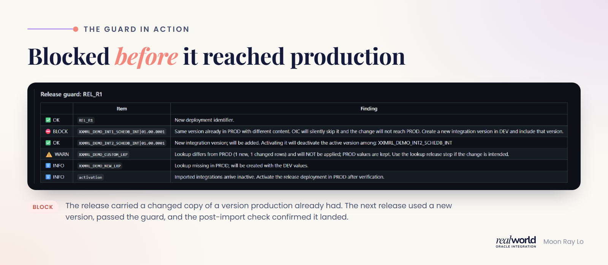

<details>
<summary><b>Screenshots: the workflows running on GitHub</b> (3 screenshots)</summary>

<br>

The `oic-dev` branch after a push: OIC's "API client checkin" commits, followed by the Expand workflow's commit naming the project:

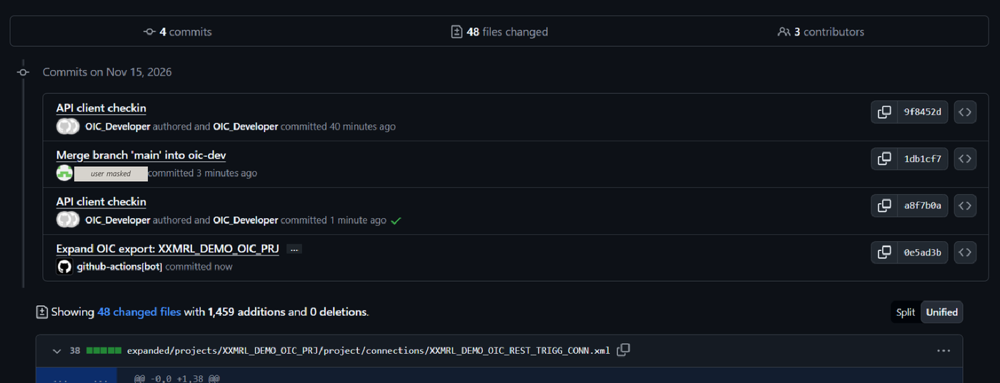

A pull request into `main` with the Release guard check passing:

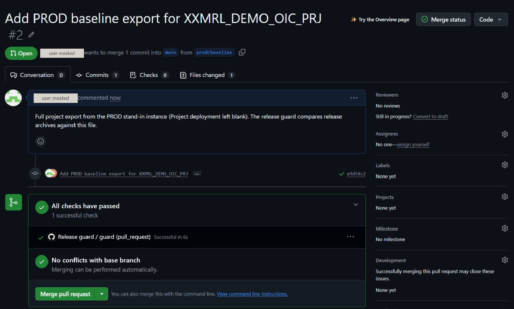

Verify PROD after the production baseline is merged (no release archives on `main` yet):

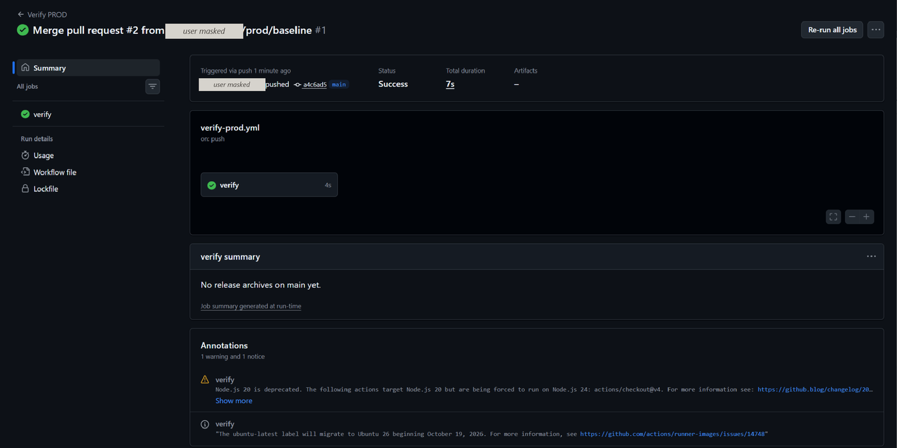

</details>

## What makes it production-ready

| Property | How the blueprint delivers it |
|---|---|
| **Guarded releases** | Every release pull request is checked against the latest production export. A blocking finding fails the pull request before anything is imported. |
| **Proof that the release landed** | After each import, Verify PROD confirms every released integration version is in production with exactly the released content. It catches OIC's silent skip, which the import screen reports as success. |
| **No rebuilt artifacts** | Production always receives the untouched `.car` file OIC exported. Git is a readable mirror and a set of checks; nothing is rebuilt from it. |
| **A self-testing pipeline** | The guard runs its regression tests on real exports from the lab (identifiers replaced) before every check, so a broken tool can't pass a release. |
| **Simple rollback** | Every change is a new integration version, so rollback is one step: deactivate the new version and reactivate the previous one. |
| **Least-privilege access** | OIC uses a fine-grained token limited to one repository with Contents access only; the workflows need nothing beyond the repository's own `GITHUB_TOKEN`. |
| **Clear ownership** | The one manual step (committing the production export) has a named owner on the release checklist. |
| **No dependencies** | Python standard library only, on any GitHub-hosted runner. Nothing to install, patch or license. |

**Before you rely on it in production,** add what the lab didn't cover: branch protection on `main` (required approval and a passing Release guard check), the repository connected to the DEV instance only, client repositories in the client's own GitHub organization, a test of connection behavior on import, and a rerun of the tests against your own exports after each Oracle Integration upgrade.

## Try it with the demo exports

The `tests/fixtures` folder holds exports from the hands-on lab with identifiers replaced (email address and OCIDs). They include the release whose same-version change OIC silently skipped.

```text
cd guides/oic-cicd
python tools/oicci.py check tests/fixtures/release_REL_R1.car --prod tests/fixtures/prod_before_R1.car
python tools/oicci.py verify tests/fixtures/release_REL_R1.car --prod tests/fixtures/prod_after_R1.car
python -m unittest discover -s tests
```

The first command blocks the release:

```text
| ⛔ BLOCK | `XXMRL_DEMO_INT1_SCHEDB_INT|01.00.0001` | Same version already in PROD with different content.
           OIC will silently skip it and the change will not reach PROD. Create a new integration
           version in DEV and include that version. |
```

The second shows what happened when that release was imported anyway: OIC reported success, and the check finds the integration version in production with the old content.

| Fixture | What it is |
|---|---|
| `dev_nochange1.car`, `dev_nochange2.car` | Two DEV project exports with no change between them |
| `dev_int1_edit_same_version.car` | DEV export after editing INT1 01.00.0000 in place |
| `dev_full_project.car` | DEV full project export (deployment left blank) |
| `release_REL_R1.car` | Deployment: INT1 01.00.0001 (same-version edit) and INT2 01.00.0001 (new) |
| `release_HOTFIX_INT1_101.car` | Deployment whose identifier already exists in production |
| `prod_before_R1.car`, `prod_after_R1.car` | Production exports before and after importing REL_R1 |

## Set it up in your repository

1. **Create a private GitHub repository** with two branches, `main` and `oic-dev`. OIC's GitHub integration supports github.com only.
2. **Copy the files** from this folder into the repository root:

   ```text
   tools/oiccar.py
   tools/oicci.py
   tests/                      (keep it: the release guard runs the self-test first)
   .github/workflows/          (the three files from workflows/ here)
   .gitattributes              (contains: *.car binary)
   ```

   Commit them to both branches. The guard runs from `main`'s pull request context and the expand workflow from `oic-dev`.
3. **Create a fine-grained personal access token** for OIC: resource owner is the repository owner, **Only select repositories** (this repository), permission **Contents: Read and write**. Set an expiration date and put the renewal on your calendar; OIC stops pushing when the token expires.
4. **Connect OIC DEV:** **Settings > Repository** in the Oracle Integration console. This needs the ServiceAdministrator role. Enter the GitHub user name (not an email address), the repository name, branch `oic-dev` and the token. Select **Test**, then **Save**.
5. **First install in production:** export the project from DEV with Project deployment left blank, import it into production (**Projects > Add > Import**), then export production the same way and commit it to `main` as `prod-state/<PROJECT>.car`. That file is what the guard compares every later release against.
6. **On Windows clones,** run `git config core.longpaths true` once (expanded paths can pass 260 characters) and keep the clone in a local folder such as `C:\dev`, not a synced folder.

<details>
<summary><b>Screenshots: connecting OIC to GitHub</b> (7 screenshots)</summary>

<br>

The fine-grained token: one repository, Contents read and write:

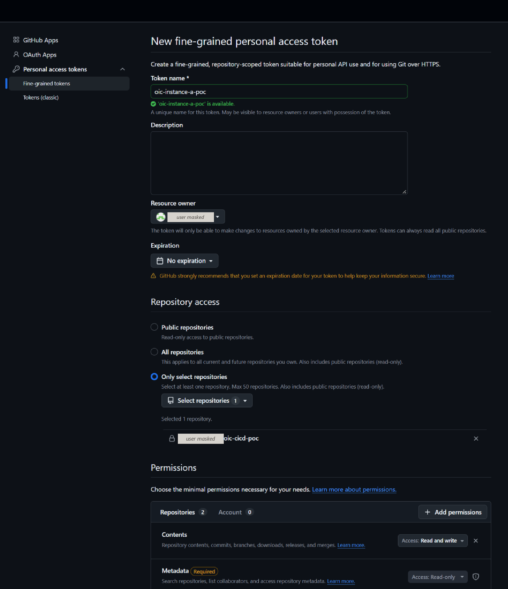

Settings > Repository before and after the connection (token masked):

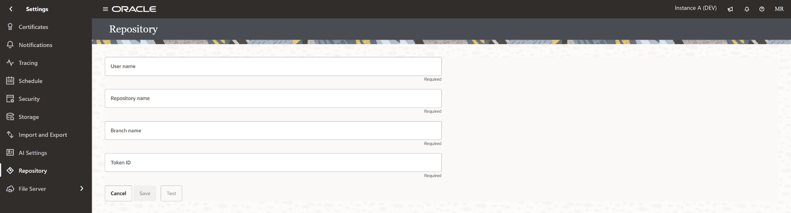
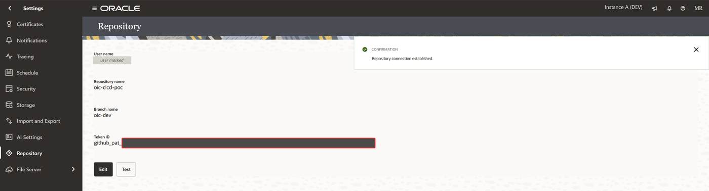

Export to Repository, and the push on GitHub:

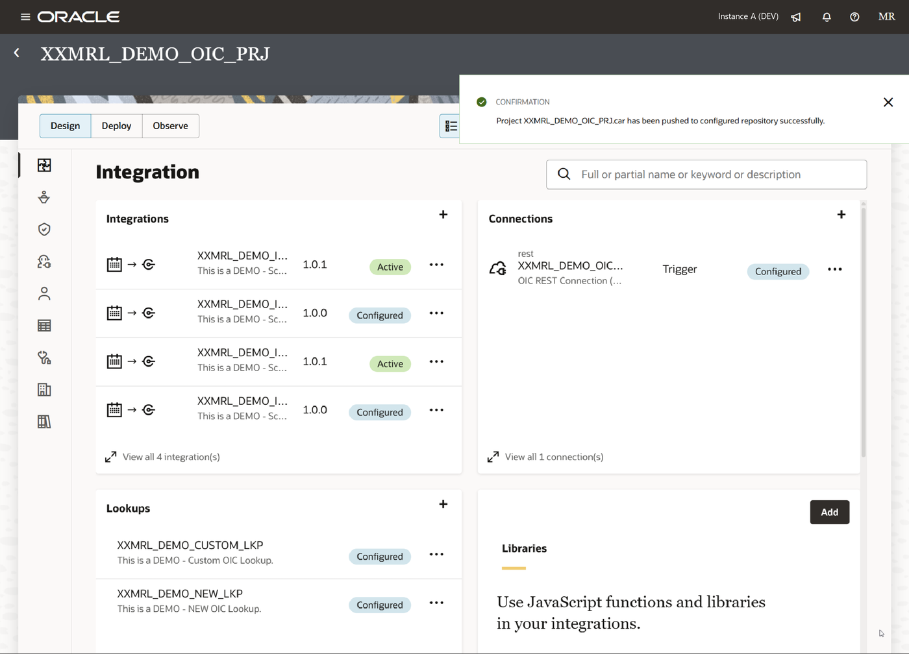
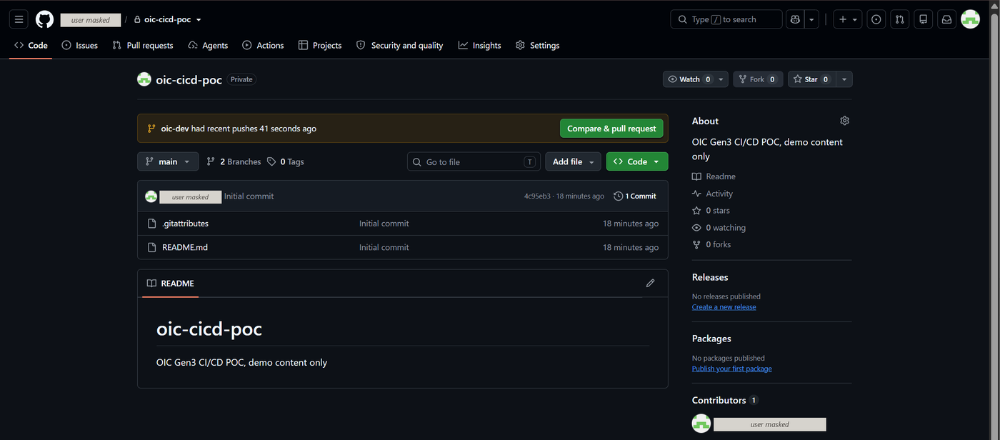

Without the Expand workflow, this is all Git sees: one binary archive.

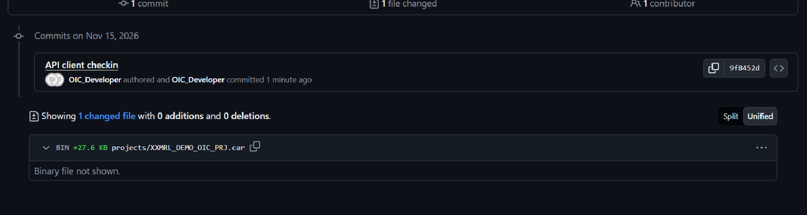

When you export a project, the Project deployment field is optional. Blank means a full project archive (first install and production state); a deployment means a release archive.

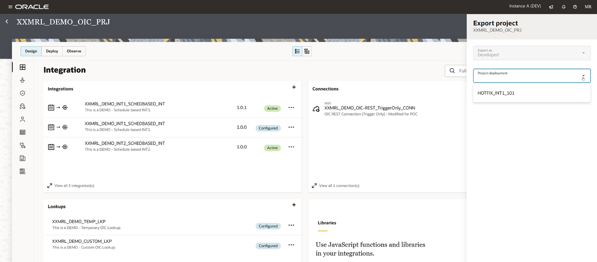

</details>

Recommended for production, not covered by the lab: protect `main` so a pull request needs an approval and a passing **Release guard** check before it merges; connect only the DEV instance to the repository; and keep client repositories in the client's own GitHub organization.

## Release runbook

1. **In DEV,** create a new integration version for every change and test it.
2. **Create a project deployment** with a new identifier (for example `REL_20261115_INT1`) holding only the versions to release, then **Export > Export to Repository** for the deployment. The Expand workflow commits the readable tree.
3. **Open a pull request** from `oic-dev` to `main`, one release per pull request. Read the Release guard summary on the pull request and fix every BLOCK in DEV (usually: create a new version and a new deployment).
4. **Merge,** then import the same deployment `.car` into production: **Projects > Add > Import**.
5. **Export production** (Project deployment left blank) and commit it to `main` as `prod-state/<PROJECT>.car`. **Verify PROD** runs and confirms the release landed.
6. **Activate** the release deployment in production and smoke test.

**Lookup changes** never arrive with a release (behavior 4). Plan a separate, controlled lookup update, for example the lookup archive REST endpoint with Import (Replace).

**Rollback:** deactivate the new integration version and reactivate the previous one. Roll back the faulty integration, not the whole deployment.

**Ownership:** step 5 is manual and needs a named owner after go-live. Put it on the release checklist next to activation and the smoke test.

<details>
<summary><b>Worked example: release REL_R2, end to end</b> (9 screenshots)</summary>

<br>

**Step 1.** The fix done properly: INT1 1.0.2, a new version.

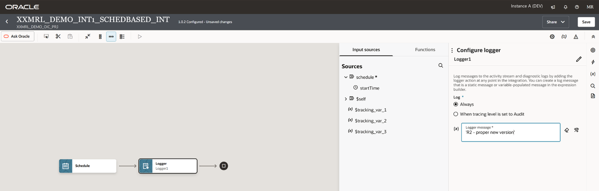

**Step 2.** Create the deployment, choose only the versions to release, and push it.

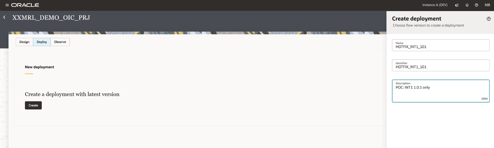
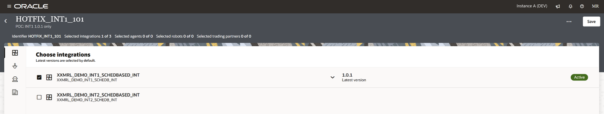
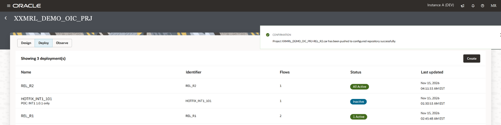

**Step 3.** The release pull request, with the Release guard passing.

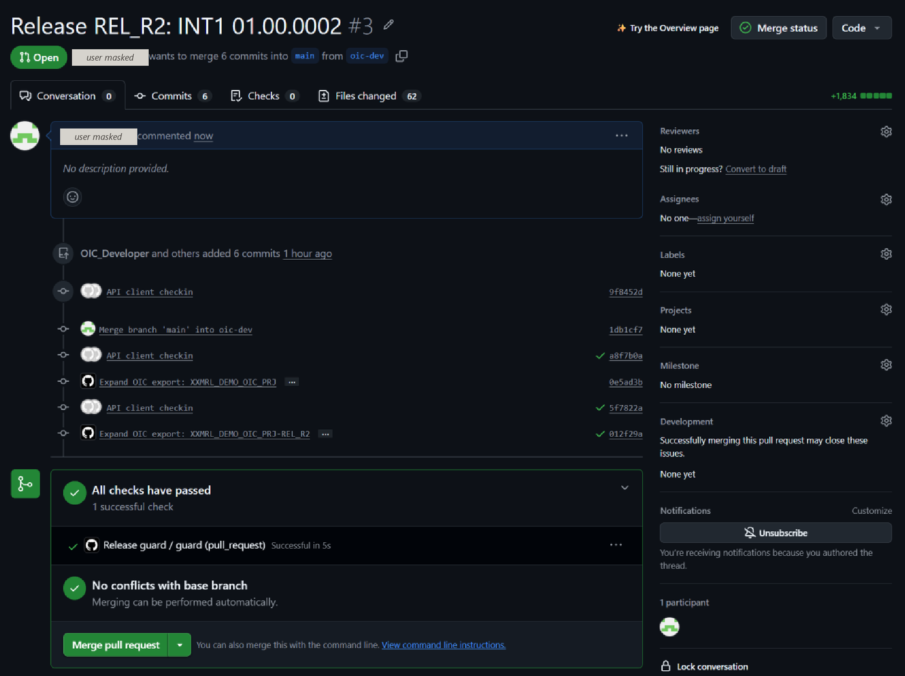

**Step 4.** Import into production: INT1 1.0.2 is added, Configured.

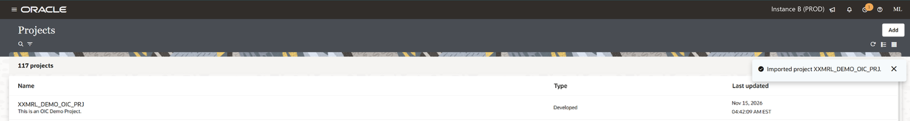
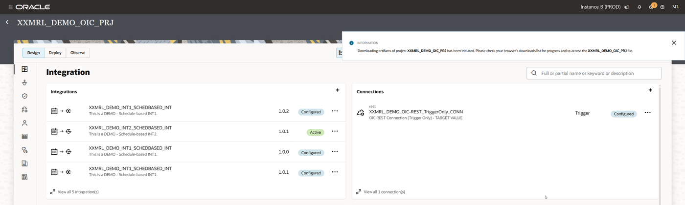

**Step 5.** Commit the production export, and Verify PROD confirms REL_R2 landed: the deployment is present and INT1 01.00.0002 content matches. The WARN reminds you it is not active yet (step 6).

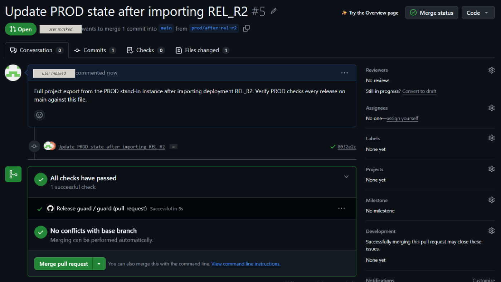
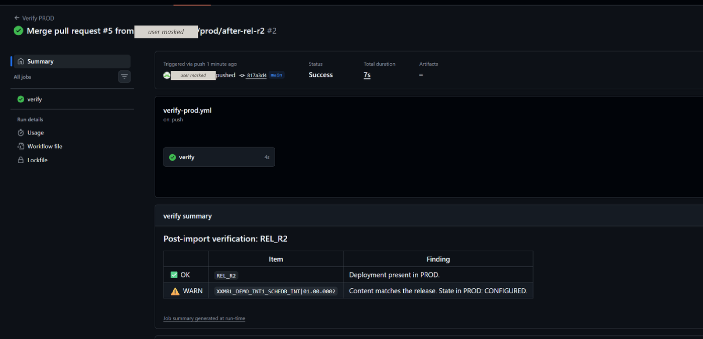

</details>

## Guard and verify findings

| Level | Meaning |
|---|---|
| ⛔ BLOCK | OIC would reject the import or silently not apply part of it (guard), or the release did not land (verify) |
| ⚠️ WARN | Will import, but something keeps its production value, or a released version is not active yet |
| ℹ️ INFO | Expected effect, for the reviewer |
| ✅ OK | No action |

The guard blocks a full project archive for a project already in production, a deployment identifier already imported, and an integration version already in production with different content. It warns when a lookup or connection in the release differs from production and won't be applied.

## Tool reference

```text
python tools/oicci.py expand     <car> <out_dir>                 write the cleaned review tree
python tools/oicci.py summary    <car> [--previous <car>]        what changed, per integration (commit text)
python tools/oicci.py check      <release.car> [--prod <car>]    pre-import guard; exit 1 on a blocking finding
python tools/oicci.py verify     <release.car> --prod <car>      post-import check; exit 1 if the release did not land
python tools/oicci.py verify-all <releases_dir> --prod <car>     verify every release of that project already imported
python tools/oicci.py info       <car> --field project|deployment
```

When `GITHUB_STEP_SUMMARY` is set, findings are also written to the job summary.

## Limitations and things that tripped me up

* **The repository setting is instance-wide.** Anyone who uses Export to Repository on that instance pushes to the same repository and branch. Agree who owns it before you turn it on.
* **OIC's commits carry no developer identity.** Every push is "API client checkin" by OIC_Developer; the expand commit reads who changed what from `project.yaml`.
* **Windows path length and synced folders:** see setup step 6.
* **Connections** are assumed to behave like lookups; not tested here.
* The scripts read the `.car` layout of Oracle Integration 3 as of 26.10. Oracle can change it in any release: rerun the tests against your own exports after an upgrade.

## Oracle sources

* [Integrate Projects and Project Deployments with a GitHub Repository](https://docs.oracle.com/en/cloud/paas/application-integration/integrations-user/integrate-projects-github-repository.html)
* [Export a Project](https://docs.oracle.com/en/cloud/paas/application-integration/integrations-user/export-project.html)
* [Create or Import a Project](https://docs.oracle.com/en/cloud/paas/application-integration/integrations-user/create-or-import-project.html)
* [REST API: Export a Project](https://docs.oracle.com/en/cloud/paas/application-integration/rest-api/op-ic-api-integration-v1-projects-id-archive-post.html)
* [REST API: Import (Add) a Project](https://docs.oracle.com/en/cloud/paas/application-integration/rest-api/op-ic-api-integration-v1-projects-archive-post.html)
* [REST API: Export a Project to Git Repository](https://docs.oracle.com/en/cloud/paas/application-integration/rest-api/op-ic-api-integration-v1-gitprojects-projectid-exporttorepository-post.html)
* [Oracle Integration blog: CI/CD Approaches for Oracle Integration](https://blogs.oracle.com/integration/ci-cd-approaches-for-oracle-integration)

## Revision history

| Version | Date | Change |
|---|---|---|
| 1.0 | November 2026 | First public version: tools, workflows, demo exports and setup guide. |
| 1.1 | November 2026 | Framed as a production-ready blueprint: "What makes it production-ready" section, 34 lab screenshots, newsletter links. |

---

## Follow the newsletter

This guide is the hands-on companion to **[Edition #5 of Real-World Oracle Integration](https://www.linkedin.com/pulse/oracle-integration-cicd-integration-level-git-oic-3-lo-psm-ii-4c20e/)**, my LinkedIn newsletter: production-tested Oracle Integration patterns, one edition at a time. Subscribe for the next edition, and connect with me if you want to compare notes on your own setup.

[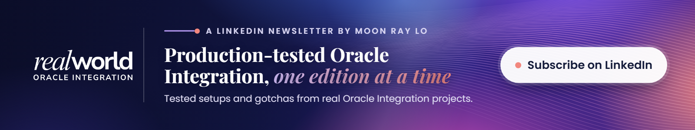](https://www.linkedin.com/newsletters/real-world-oracle-integration-7513260462159888384)

**[Subscribe to the newsletter](https://www.linkedin.com/newsletters/real-world-oracle-integration-7513260462159888384)** · **[Connect on LinkedIn](https://www.linkedin.com/in/moonraylo)** · **[Oracle ACE profile](https://ace.oracle.com/ords/ace/oapt/profile/moonraylo)**

*Moon Ray Lo, Oracle ACE Apprentice. The postings on this site are my own and do not represent Huron's positions, strategies or opinions. Oracle features and behavior change between releases: confirm each step against Oracle's current documentation for your version, and test in non-production first. Scripts are provided as-is, without warranty.*
